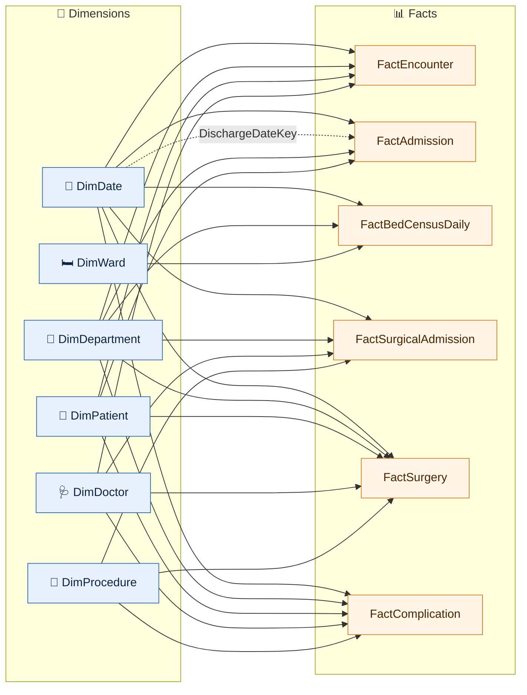

# hospital-intelligence-analytics
# 🏥 Hospital Intelligence — Clinical & Operational Analytics

**End-to-end healthcare analytics project:** a normalized SQL Server database (24 tables, ~619K rows), a validated CSV import pipeline, and an interactive Power BI dashboard that helps hospital management monitor patient flow, bed capacity, surgical outcomes, readmissions and revenue cycle.

> ⚠️ All data is **fully synthetic** (seed `20261017`). It contains no real patient records and should not be read as a clinical benchmark. This is a portfolio project.

---

## 📌 Business Problem

Hospital data is usually spread across separate systems: registration, inpatient care, the operating theatre, the lab and billing. Managers need a single place to answer questions like these:

- How are visits split between outpatient, inpatient and emergency care, and how does demand change over time?
- Which wards are close to capacity, and how long do patients stay?
- Which procedures have the highest complication and readmission risk?
- How many patients return within 30 days of discharge?
- How much revenue is lost to claim denials, and why?

---

## 🗂️ Repository Structure

```
├── sql/
│   ├── 01_create_schema.sql                               # Database, 24 tables, PK/FK/CHECK constraints
│   ├── Hospital_Intelligence_SQL_Only_Import_24_Tables.sql # BULK INSERT loader (staging → dbo, FK-safe)
│   └── 08_validate_data.sql                               # Data-quality rules (all ViolationCount = 0)
├── data/
│   └── full_csv/                                          # 24 CSV files + dataset_manifest.json
├── powerbi/
│   └── Hospital_Intelligence.pbix                         # Power BI dashboard
├── docs/
│   └── SQL_SETUP.md                                       # Step-by-step SSMS loading guide
└── images/                                                # Dashboard screenshots
```

---

## 🧱 Data Model

The database is `HospitalIntelligenceDB` on SQL Server 2017+. It covers 24 tables in five domains:

| Domain | Tables |
|---|---|
| **Master data** | Patients, Departments, Doctors, Wards, Beds, Diagnoses, ProcedureTypes, Insurers |
| **Patient flow** | Encounters, OutpatientVisits, Admissions, Discharges, BedAssignments, BedBlocks |
| **Clinical** | EncounterDiagnoses, Surgeries, Complications, LabTests, MedicationOrders, PatientObservations, ClinicalAlerts |
| **Revenue cycle** | Claims, ClaimDenials, Payments |

**Design highlights**
- `Encounters` is the central fact. `OutpatientVisits` and `Admissions` are its 1 : 0..1 subtypes, so one encounter is either a visit or a hospitalization, never both.
- Bed availability is derived from time intervals in `BedAssignments` and `BedBlocks`, with no overlap rules.
- Referential integrity is enforced with foreign keys, and business rules with CHECK constraints. Both are verified by `08_validate_data.sql`.

### Dataset size

| Table | Rows | Table | Rows |
|---|---:|---|---:|
| Patients | 20,000 | Admissions | 12,630 |
| Encounters | 49,923 | Surgeries | 2,574 |
| OutpatientVisits | 37,293 | Complications | 158 |
| PatientObservations | 181,076 | Claims | 41,954 |
| LabTests | 62,890 | Payments | 43,294 |
| MedicationOrders | 62,368 | **All 24 tables** | **618,935** |

Period: **Oct 2024 to Sep 2026** (2 years).

---

## ⭐ Power BI Semantic Model

The report uses a star schema in the `bi` schema. **6 fact tables** share **6 conformed dimensions**:

| Dimensions | Facts |
|---|---|
| DimDate · DimPatient · DimDepartment · DimDoctor · DimWard · DimProcedure | FactEncounter · FactAdmission · FactBedCensusDaily · FactSurgicalAdmission · FactSurgery · FactComplication |

### Model structure



**Bus matrix: which dimension filters which fact**

| | FactEncounter | FactAdmission | FactBedCensusDaily | FactSurgicalAdmission | FactSurgery | FactComplication |
|---|:-:|:-:|:-:|:-:|:-:|:-:|
| **DimDate** (DateKey) | ✅ | ✅ ➕ discharge date* | ✅ | ✅ | ✅ | ✅ |
| **DimDepartment** (DepartmentID) | ✅ | ✅ | ✅ | ✅ | ✅ | ✅ |
| **DimPatient** (PatientID) | ✅ | ✅ | | | ✅ | ✅ |
| **DimDoctor** (DoctorID) | ✅ | | | ✅ | ✅ | ✅ |
| **DimProcedure** (ProcedureTypeID) | | | | ✅ | ✅ | ✅ |
| **DimWard** (WardID) | | | ✅ | | | |

\* inactive relationship (dashed line), used only when a measure needs discharge-date analysis.

<details>
<summary>Power BI model view (screenshot)</summary>


</details>

- `FactBedCensusDaily` holds a daily ward-level snapshot of operational, occupied, blocked and available beds, which makes occupancy measures straightforward.
- `FactSurgicalAdmission` carries one row per surgical admission, with flags for complications and 30-day readmission eligibility. It feeds the procedure risk matrix.
- Relationships are one-to-many, from dimension to fact. The dashed lines in the diagram are inactive relationships, such as a second date like the discharge date. A measure turns one on when it needs it.

---

## 📊 Dashboard

The dashboard measures are written in DAX on top of this model.

- **Executive Overview:** visit trends, the encounter mix (outpatient / inpatient / emergency) and volume by department.
- **Hospital Operations:** bed occupancy by ward, length of stay, and department performance over time.
- **Clinical & Surgical Analytics:** surgery volume, complication severity, and a procedure risk matrix of complications vs 30-day readmissions.
- **Patient Access:** patient regions, the age pyramid, referral sources, and visit patterns by weekday and hour.

<!-- Screenshots: add images to /images and reference them here, e.g.

-->

---

## 💡 Key Figures (from the dataset)

| Metric | Value |
|---|---:|
| Encounter mix | 61.9% outpatient · 23.9% inpatient · 14.2% emergency |
| Average length of stay | 5.2 days |
| 30-day readmission rate | 4.4% |
| Surgeries with a complication | 6.1% |
| Discharged home | 90.9% |
| Claim denial rate | 11.3% |


## ⚙️ Tech Stack

`SQL Server` · `T-SQL` · `Power BI` · `DAX` · `Star Schema` · `Data Modeling` · `Data Validation`

🤖 Built with assistance from **Anthropic Claude** through the Power BI Modeling MCP, which was used for relationships, DAX measures and calculation checks. Responsibility for the correctness of the results stays with the analyst.

---

## 👤 Author

**Giorgi Shengelia** · Data Analyst
GitHub: [@giorgi2003141](https://github.com/giorgi2003141)
